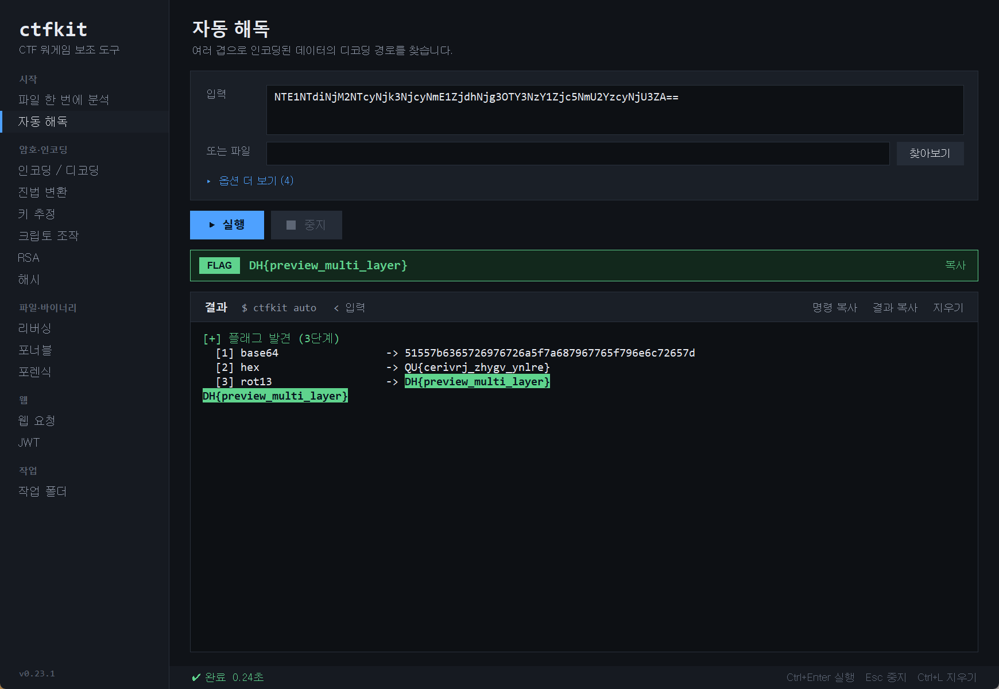

# ctfkit

드림핵(Dreamhack) 워게임 학습을 위한 CTF 보조 도구.
인코딩/디코딩과 고전 암호 해독부터 HTTP 요청(curl 재현)·브루트포스·파일 분석까지,
CTF 풀이에 반복되는 작업 대부분을 터미널 명령어 하나나 그래픽 화면(`ctfkit ui`)으로 처리하는 올인원 도구를 목표로 합니다.

> 📚 오픈소스소프트웨어 수업 텀 프로젝트로 개발 중입니다. CTF/워게임 학습 과정에서
> 반복적으로 필요했던 작업들을 직접 도구로 만들어 가며 배웁니다.
> **AI 활용:** 코드와 테스트의 대부분은 AI(Claude Code)가 작성했고, 저는 방향 설정·기능 요청·코드 리뷰와
> 수정 요청을 맡았습니다. 작업 방식은 [ROADMAP](docs/ROADMAP.md#개발-방식)과 [개발 일지](docs/devlog.md)에 기록합니다.


> 데모는 로컬 테스트 서버와 직접 만든 예제 파일을 대상으로 한 실제 명령 출력입니다.

## 설치

Python 3.10 이상이 필요합니다. PyPI에는 배포하지 않았으므로 저장소에서 설치합니다.

```bash
git clone https://github.com/Seobyeong/ctfkit.git
cd ctfkit
pip install .            # 기본 기능 (외부 의존성 없음)
pip install ".[image]"   # forensic lsb 까지 사용 (Pillow 설치)
pip install ".[rev]"     # rev disasm 까지 사용 (capstone 설치)
ctfkit --version
```

명령별 요약은 [docs/USAGE.md](docs/USAGE.md), 구조 설명은 [docs/ARCHITECTURE.md](docs/ARCHITECTURE.md)를 참고하세요.

## 그래픽 화면

명령어를 외우지 않아도 되도록 Tkinter 화면을 제공합니다. 추가 설치 없이 실행됩니다
(Linux에서 Tkinter가 없으면 `python3-tk` 패키지를 설치하세요).

```bash
ctfkit ui
```



- 모든 명령을 입력 칸과 파일 선택 버튼으로 실행하고, 같은 동작의 CLI 명령도 함께 보여 줍니다.
- 작업은 별도 프로세스에서 돌아가므로 퍼징처럼 오래 걸려도 화면이 멈추지 않고, 언제든 중지할 수 있습니다.
- 화면은 CLI의 argparse 정의에서 자동으로 만들어지므로, 새 명령이나 변환을 추가하면 화면에도 바로 나타납니다.

## 상태

진행 중 — **Phase 1(드림핵 전 분야 기본기) 완료**, 이제 **Phase 2(분야별 심화)** 진행 중입니다.

- ✅ **동작:** `codec`, `auto`, `crack`, `crypto`, `base`, `web`, `hash`, `forensic`, `jwt`, `rev`, `pwn`, `workspace` + 그래픽 화면(`ui`), 플러그인 레지스트리, pytest(376개), GitHub Actions CI
- ✅ **분야 커버:** 웹 · 암호 · 포렌식 · 리버싱 · 포너블 · misc — 드림핵 6개 분야 기본기 완료
- 🔶 **심화(Phase 2 진행 중):** `crack` 비즈네르 언덕 오르기+바이그램 점수(짧은 암호문 복구력 향상) — 다음 후보: 치환암호 빈도 분석, XOR 키길이 추정, RSA 기초
- 🔶 **마무리 예정:** 모듈별 실제 풀이 사례

자세한 계획과 진행 상황은 [docs/ROADMAP.md](docs/ROADMAP.md)를 참고하세요.

## 기능

| 모듈 | 설명 | 상태 |
| --- | --- | --- |
| `codec` | 인코딩/디코딩 (base64/58/32/85·ascii85, hex, URL, ROT13, 시저, 비즈네르, XOR) | ✅ |
| `base` | 진법 변환 (2/8/10/16 상호 변환, 0x/0o/0b 자동 인식) | ✅ |
| `auto` | 여러 겹으로 인코딩된 문자열을 자동 추정해 단계별로 복원 | ✅ |
| `crack` | 키 없이 고전 암호(시저·비즈네르·XOR) 해독 | ✅ |
| `web` | HTTP 요청·curl 재현·퍼징·접두사 오라클·CBC 패딩 오라클·응답 diff (allowlist 전용) | ✅ |
| `crypto` | 키 없이 하는 블록 암호 바이트 조작 (CBC 비트플립, PKCS7 패딩) | ✅ |
| `hash` | 해시 종류 판별, 사전 기반 브루트포스, HMAC 계산 | ✅ |
| `forensic` | 파일 형식·문자열·숨은 파일·EXIF 메타데이터·ZIP 목록·pcap 문자열, 이미지 LSB(Pillow 필요) | ✅ |
| `jwt` | JWT 디코드, `alg:none`·재서명 변조, HS256 시크릿 사전 공격 | ✅ |
| `rev` | ELF/PE 아키텍처·섹션·심볼 요약, 디스어셈블(capstone 필요) | ✅ |
| `pwn` | 보호 기법 확인(checksec), cyclic 패턴·오프셋, ROP 가젯(capstone 필요) | ✅ |
| `workspace` | 문제별 작업 폴더·명령 기록·풀이 노트 관리 | ✅ |

## 사용 예시

동작하는 기능:

```
$ ctfkit codec decode base64 "ZmxhZ3toZWxsb30="
flag{hello}

$ ctfkit auto "NjY2YzYxNjc3YjY4Njk3ZA=="
[+] 플래그 발견 (2단계)
  [1] base64                 -> 666c61677b68697d
  [2] hex                    -> flag{hi}
flag{hi}
```

```
# 해시 종류 판별 + 사전 기반 브루트포스
$ ctfkit hash id 5f4dcc3b5aa765d61d8327deb882cf99
가능한 종류 (3): md5, md4, ntlm
$ ctfkit hash crack 5f4dcc3b5aa765d61d8327deb882cf99 --words words.txt
[+] 찾음: password  (md5, 42개 시도)

# 파일 뒤에 숨겨 붙인 파일(트레일러) 탐지 후 추출
$ ctfkit forensic carve stego.png --dump hidden.zip
[+] 숨은 파일 시그니처 1개:
  오프셋 0x1a2b (6699)  ZIP

# HTTP 요청 반복 / 파라미터 퍼징 (allowlist 대상에만, 속도 제한 내장)
$ ctfkit web fuzz "http://localhost:8000/?id=FUZZ" --words ids.txt --hide 404

# curl 명령을 그대로 붙여 재현 (쿠키 유지)
$ ctfkit web curl "curl -X POST -d 'user=admin' http://localhost:8000/login" --cookies jar.txt

# 문제별 작업 폴더·노트·명령 기록
$ ctfkit workspace new web-100
$ ctfkit workspace log web-100 ctfkit web send http://localhost:8000/
```

> `web`·`hash`·`forensic`·`jwt`·`workspace` 모듈은 외부 의존성 없이 파이썬 표준 라이브러리만 사용합니다
> (단, `forensic lsb` 이미지 LSB 추출은 저장소에서 `pip install ".[image]"` 로 Pillow 를 설치해야 합니다).

## ⚠️ 사용 범위와 윤리 (중요)

이 도구, 특히 `web`·`hash` 등 요청/대입 기능은 **학습 목적으로만** 사용합니다.

- **허가된 대상에만 사용합니다.** 드림핵이 문제로 제공한 워게임 인스턴스, `localhost`,
  본인이 직접 띄운 실습 서버만 대상으로 합니다.
- 허용 도메인 목록(allowlist)에 없는 주소로는 요청을 보내지 않도록 설계합니다.
- 드림핵 사이트 본체(로그인·채점·플래그 제출)를 자동화하지 않습니다.
- 요청 반복·브루트포스 기능에는 속도 제한과 총량 상한을 둡니다.
- 허가받지 않은 시스템에 대한 사용은 불법일 수 있으며, 그 책임은 사용자에게 있습니다.

## 참고한 도구

설계·아이디어 면에서 다음 오픈소스/도구를 참고했습니다. 이 도구들의 코드를 가져다 쓰지는 않았고,
ctfkit의 코드는 위 "AI 활용"에 적은 방식으로 작성했습니다.

- [CyberChef](https://github.com/gchq/CyberChef) "Magic" — 자동 디코딩 아이디어
- [Ciphey](https://github.com/Ciphey/Ciphey) — 다단계 복호화 탐색
- `curl` — HTTP 요청 인터페이스 참고
- [binwalk](https://github.com/ReFirmLabs/binwalk) — 파일 분석(`forensic`) 방향
- [jwt_tool](https://github.com/ticarpi/jwt_tool) — JWT 디코드·변조·공격(`jwt`) 방향
- [radare2](https://github.com/radareorg/radare2) / [Capstone](https://www.capstone-engine.org/) — 바이너리 분석·디스어셈블(`rev`) 방향
- [pwntools](https://github.com/Gallopsled/pwntools) / [checksec.sh](https://github.com/slimm609/checksec.sh) / [ROPgadget](https://github.com/JonathanSalwan/ROPgadget) — 보호 기법·cyclic·가젯(`pwn`) 방향

## 개발 메모

개발 과정 일지는 [docs/devlog.md](docs/devlog.md)에 기록합니다.

## 라이선스

[MIT](LICENSE)
